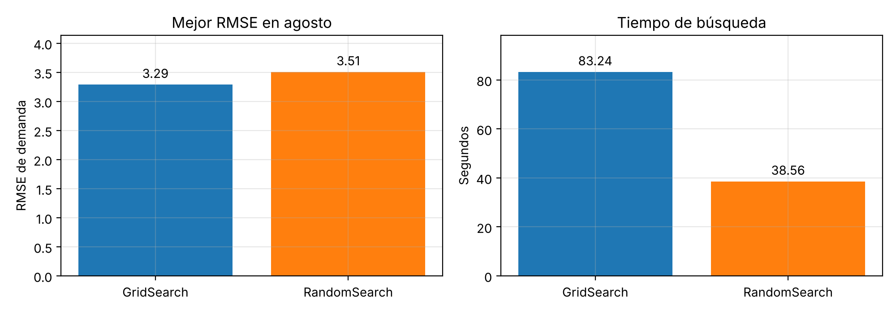
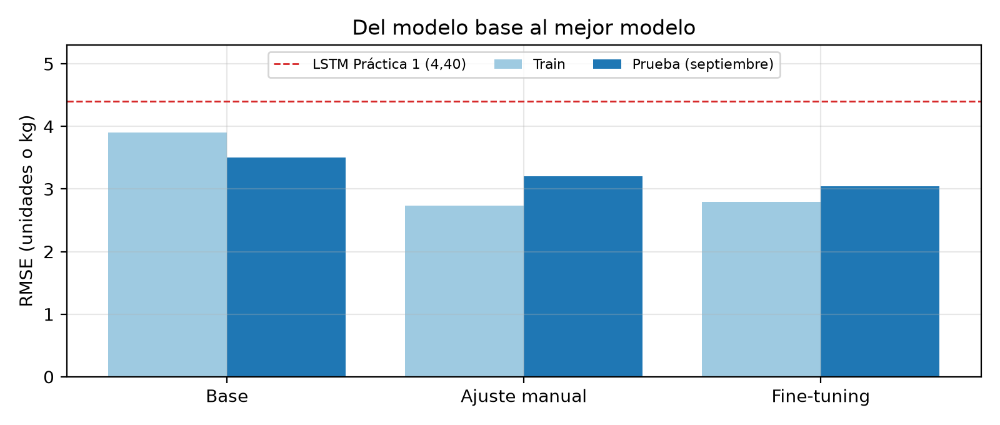
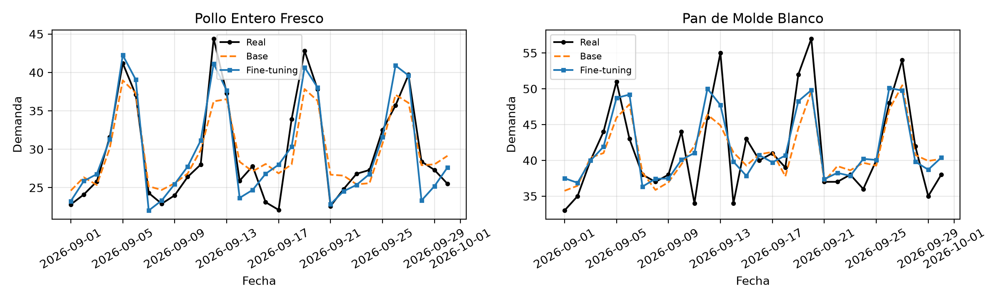
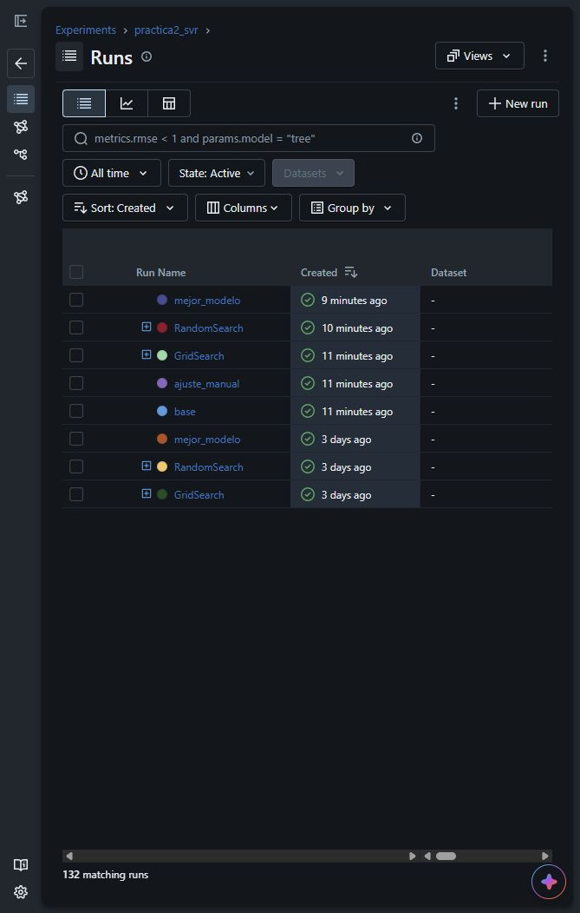
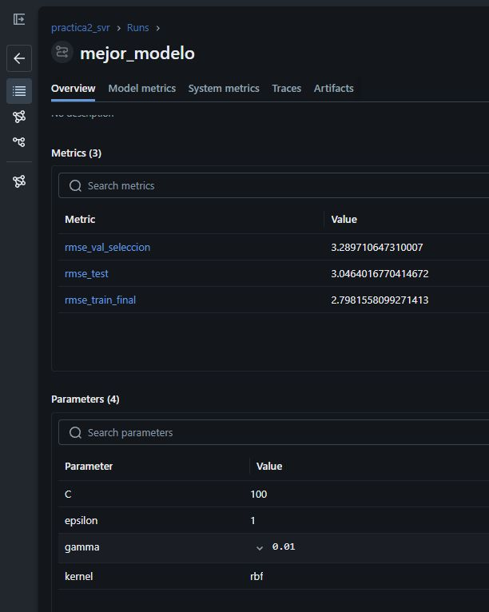
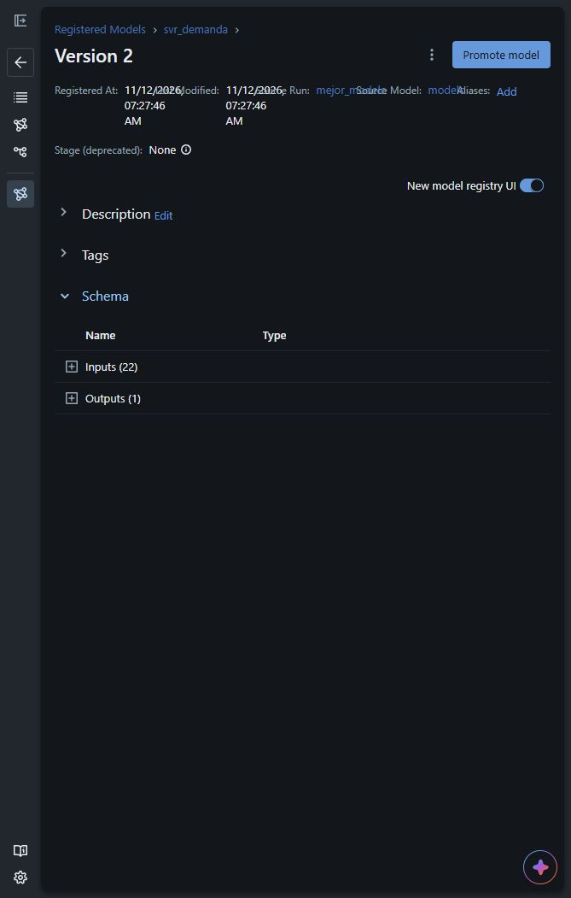

# Práctica 2: Predicción de demanda con SVM

**Aprendizaje Automático · Universidad Politécnica Salesiana**
Desarrollado por: Daniel Guanga, Alex Guamán y Cinthya Ramón · Docente: Ing. Remigio Hurtado

Predicción de la demanda diaria de 10 productos (escenario sintético de La Favorita) con **SVR**, la SVM para regresión. El modelo parte de una versión base, se mejora con fine-tuning y cada prueba queda registrada en **MLflow**. El resultado se compara con la LSTM de la Práctica 1.

## Contenido de la carpeta

| Archivo o carpeta | Contenido |
| --- | --- |
| `practica2_svm.ipynb` | Cuaderno de la práctica |
| `practica2_svm.html` | Cuaderno ejecutado, para verlo sin Python |
| `data/` | `sales_history.csv` (ventas y stock diario) e `inventory.csv` (productos) |
| `figuras/` | 7 figuras generadas por el cuaderno |
| `docs/capturas/mlflow/` | 3 capturas reales de la interfaz local de MLflow |
| `resultados/` | CSV de los experimentos y datos del modelo registrado |
| `requirements.txt` | Librerías necesarias |

`mlflow.db` y `mlartifacts/` se crean al ejecutar el cuaderno y no se suben al repositorio.

## Parte 1: Datos y modelo SVR

La variable que aprende el modelo es `cantidad_vendida`, es decir, la demanda
diaria de cada producto. Se usa regresión porque la salida es una cantidad,
en lugar de una categoría. El stock de cierre se calcula a partir del stock
disponible y las ventas; no es la variable objetivo del SVR.

### Preparación y división temporal

- 22 variables por fila: fecha como timestamp, calendario (día, mes, feriados de Ecuador, víspera, día de pago, Navidad), rezagos de venta, stock del día anterior y producto.
- De las 3.650 filas originales quedan 3.580 después de retirar las que no tienen historial suficiente para calcular los rezagos.
- División por fechas: 2.980 filas de entrenamiento hasta el 1 de agosto de 2026, 300 de validación del 2 al 31 de agosto y 300 de prueba en septiembre. No se barajan las fechas.

Los rezagos y la media móvil utilizan ventas de días anteriores de cada
producto. Esto evita introducir la venta del mismo día entre sus propias
entradas. La división temporal reproduce el orden del problema: aprender del
pasado y evaluar fechas posteriores.

### Kernels y ajuste manual

El pipeline combina `StandardScaler` y `SVR`. El escalado evita que variables
con magnitudes muy distintas, como el timestamp y los indicadores de producto,
dominen el ajuste por su escala.

| Parámetro | Qué controla |
| --- | --- |
| Kernel | La forma de la relación: lineal, RBF o polinomial |
| C | La penalización de los errores fuera del margen; un valor mayor reduce la regularización |
| Gamma | Un coeficiente de los kernels RBF y polinomial; en RBF controla el alcance de la influencia de las muestras. No interviene en el kernel lineal |
| Épsilon | La anchura del margen dentro del cual el error no recibe penalización |

Estas definiciones corresponden a los parámetros de
[`SVR` de scikit-learn](https://scikit-learn.org/stable/modules/generated/sklearn.svm.SVR.html).

Se prueban los kernels lineal, RBF y polinomial con el mismo C. En validación,
sus RMSE son 4,24; 3,58 y 3,63, respectivamente. Con RBF se estudian C y épsilon
por separado y se eligen C = 10 y épsilon = 0,1. El modelo se reajusta con
entrenamiento y agosto antes de medir su resultado en septiembre: RMSE 3,21 y
MAE 2,29. Las cuatro primeras figuras muestran estas comparaciones y las
predicciones frente a las ventas reales de dos productos.

El error de entrenamiento sirve para comprobar cuánto se ajusta el modelo a
los datos que conoce. La elección se basa en validación: reducir solo el error
de entrenamiento puede llevar a sobreajuste y empeorar las predicciones de
fechas posteriores.

## Parte 2: Optimización y registro con MLflow

La optimización parte del SVR lineal por defecto y del ajuste manual de la
Parte 1. GridSearch y RandomSearch prueban combinaciones de hiperparámetros
para buscar un menor error de validación.

### Qué es MLflow y para qué se usa aquí

MLflow es una plataforma para gestionar experimentos y modelos. Su componente
Tracking guarda los parámetros, las métricas y los archivos de cada prueba,
y permite consultarlos en una interfaz web.
[Documentación de MLflow Tracking](https://mlflow.org/docs/latest/ml/tracking/).

| Concepto | Ejemplo en esta práctica |
| --- | --- |
| Experimento | `practica2_svr` agrupa las pruebas |
| Run o ejecución | Un modelo base, una búsqueda o un candidato |
| Parámetros | Kernel, C, gamma y épsilon utilizados |
| Métricas | `rmse_train`, `rmse_val` y `tiempo_fit_s` |
| Artefactos | Figuras, CSV y archivos del modelo entrenado |

Con 62 candidatos entre ambas búsquedas, guardar solo el último resultado del
notebook dificultaría identificar qué combinación produjo cada error. MLflow
mantiene esa relación y el historial de las ejecuciones. Podemos comparar
pruebas anteriores sin volver a entrenarlas y abrir la figura correspondiente
a cada candidato.

La mejora del RMSE procede del ajuste de hiperparámetros. MLflow registra la
evidencia que permite comparar las alternativas; no modifica por sí solo las
predicciones del SVR. En este proyecto funciona de forma local con SQLite y
una carpeta de artefactos.

### Cómo se realizan las búsquedas

Ambas búsquedas utilizan la validación fija de agosto mediante `PredefinedSplit`.
El escalador se ajusta dentro del pipeline con entrenamiento. El conjunto de
septiembre queda fuera de la selección de parámetros.

| Parámetro | Valores explorados |
| --- | --- |
| Kernel | `linear`, `rbf`, `poly` |
| C | 1, 10, 100 |
| Épsilon | 0,1 y 1 |
| Gamma para RBF y polinomial | `scale`, 0,01 y 0,1 |

Gamma no interviene en el kernel lineal. Esto deja 6 combinaciones lineales y
36 entre RBF y polinomial. RandomSearch toma 20 del mismo espacio, sin reemplazo
y con semilla 42. Se elige el menor RMSE de agosto; si hay empate entre búsquedas,
se toma la de menor duración. Después se reajusta el modelo elegido con
entrenamiento y agosto para la evaluación final en septiembre.

GridSearch recorre las 42 combinaciones definidas. RandomSearch evalúa una
muestra de 20: necesita menos ajustes, aunque puede dejar fuera la mejor
combinación de ese espacio. Cada candidato se registra como una ejecución
hija de su búsqueda, con sus parámetros, RMSE de entrenamiento y validación,
tiempo de ajuste y figura.

### GridSearch frente a RandomSearch

| Búsqueda | Candidatos | Mejor RMSE de agosto | Tiempo de búsqueda |
| --- | ---: | ---: | ---: |
| GridSearch | 42 | 3,290 | 52,51 s |
| RandomSearch | 20 | 3,506 | 23,88 s |

En esta ejecución elegimos GridSearch porque obtuvo el menor RMSE de agosto.
RandomSearch tardó menos de la mitad y sería una alternativa si se priorizara
reducir el tiempo de búsqueda aceptando un error mayor. Los presupuestos son
distintos, 42 frente a 20 candidatos; el resultado no demuestra que GridSearch
sea siempre mejor que RandomSearch.

Los tiempos corresponden a `fit`; no incluyen guardar las figuras ni registrar
los resultados en MLflow. Pueden cambiar según el equipo y la carga de trabajo.
El archivo `resultados/parte2_comparacion.csv` conserva los valores de la última
ejecución, y MLflow permite consultar las anteriores.



### Qué modelo se elige y por qué

La combinación elegida es RBF, C = 100, gamma = 0,01 y épsilon = 1. Su RMSE
de agosto es 3,2897, el menor encontrado por las dos búsquedas. Septiembre
se utiliza después para evaluar el modelo reajustado, no para elegir estos
parámetros.

El RMSE penaliza más los errores grandes; el MAE resume la magnitud media
del error absoluto. En ambos casos, un valor menor indica menos error.
La evaluación de septiembre de 2026 es:

| Modelo | RMSE | MAE |
| --- | ---: | ---: |
| Base: SVR lineal por defecto | 3,50 | 2,50 |
| Ajuste manual: RBF, C = 10 | 3,21 | 2,29 |
| **Fine-tuning: RBF, C = 100, γ = 0,01, ε = 1** | **3,05** | **2,21** |
| LSTM (Práctica 1) | 4,40 | 3,10 |

El fine-tuning reduce el RMSE de prueba de 3,50 a 3,05 frente al modelo base,
aproximadamente un 13 %. También mejora el ajuste manual, que obtuvo 3,21.
El MAE baja de 2,50 a 2,21. Por estos resultados se conserva el SVR ajustado
entre las alternativas evaluadas, no simplemente por tener un C mayor o por
ser la versión más reciente.



La LSTM no se entrena en este notebook: sus métricas se toman de la práctica
anterior y se incluyen como referencia. Frente al RMSE reportado de 4,40,
el 3,05 del SVR es aproximadamente un 31 % menor. Esta comparación corresponde
al escenario sintético de la práctica y no demuestra que una SVR siempre
supere a una red recurrente.

### Ejemplo de demanda mensual por producto

El cuaderno suma las predicciones de septiembre por producto y las compara con
las ventas reales del mes. La suma de las diferencias absolutas entre esos
totales baja de 127,5 con el modelo base a 89,3 con el ajustado. Esto permite
observar cómo cambia una estimación mensual de pedido al mejorar la predicción.

Es una simulación basada en demanda, no una política completa de inventario:
no incorpora plazos de reposición ni stock de seguridad. Además, los productos
usan unidades o kilogramos; ese total agregado debe interpretarse como una
referencia del ejercicio y revisarse por producto.



### Registro y versiones del modelo

El Model Registry organiza modelos por nombre y versión, y los relaciona con
la ejecución de origen.
[Documentación de MLflow Model Registry](https://mlflow.org/docs/latest/ml/model-registry/).

Aquí se guarda el pipeline completo bajo el nombre `svr_demanda`, con el
escalador y el SVR entrenados. Así se conserva la transformación de las entradas
junto con el modelo. La firma describe sus 22 columnas de entrada y su salida.

La primera ejecución creó la versión 1 y la siguiente añadió la versión 2 sin
borrar la anterior. La referencia de esta ejecución es `models:/svr_demanda/2`.
El archivo `resultados/parte2_modelo.json` conserva esa URI, los parámetros y
las métricas. Una versión mayor identifica otro registro; por sí sola no
significa que el modelo tenga menos error.

## Ejecución

Los comandos son para PowerShell en Windows. Ejecutarlos desde la carpeta que
contiene este README, el notebook y los datos.

### 1. Preparar el entorno, si todavía no existe

```powershell
python -m venv .venv
.\.venv\Scripts\python.exe -m pip install -r requirements.txt
```

Si `.venv` ya está preparado, se puede pasar al siguiente paso.

### 2. Iniciar la interfaz web de MLflow

```powershell
.\.venv\Scripts\python.exe -m mlflow ui --backend-store-uri sqlite:///mlflow.db --host 127.0.0.1 --port 5000
```

Dejar esa terminal abierta y entrar a [MLflow local](http://127.0.0.1:5000).
Si la página ya abre, el servidor está funcionando y no hace falta arrancarlo
otra vez. `127.0.0.1` corresponde a este equipo; la interfaz no está publicada
en internet.

### 3. Ejecutar el notebook

En otra terminal, situada en la misma carpeta:

```powershell
.\.venv\Scripts\python.exe -m nbconvert --to notebook --execute --inplace --ExecutePreprocessor.timeout=900 practica2_svm.ipynb
.\.venv\Scripts\python.exe -m nbconvert --to html practica2_svm.ipynb
```

También se puede abrir `practica2_svm.ipynb` en un editor compatible con Jupyter,
seleccionar el Python de `.venv` y pulsar **Ejecutar todo**. La Parte 2 necesita
las variables de la Parte 1.

Ejecutar el notebook guarda resultados en MLflow, pero **no inicia el servidor
web automáticamente**. El servidor y el notebook son procesos separados. Al
terminar, actualizar la página de MLflow para ver las nuevas ejecuciones.

Cada ejecución completa vuelve a entrenar, agrega registros al historial y crea
otra versión de `svr_demanda`, sin borrar las anteriores. Para leer los resultados
existentes basta con abrir el HTML. Al cerrar el servidor o reiniciar el equipo,
el historial permanece guardado; solo habrá que volver a iniciar la interfaz.

## Interfaz de MLflow

En [MLflow local](http://127.0.0.1:5000), seleccionar **Model training** y entrar
al experimento **practica2_svr**. En **Runs** se ve el historial:

- `base`: SVR lineal antes del ajuste.
- `ajuste_manual`: RBF con los parámetros elegidos en la Parte 1.
- `GridSearch` y `RandomSearch`: una ejecución principal por búsqueda. El botón
  de expansión junto a cada nombre muestra sus candidatos.
- `mejor_modelo`: parámetros elegidos, evaluación final y pipeline guardado.

Cada candidato registra sus parámetros, `rmse_train`, `rmse_val`, `tiempo_fit_s`
y la figura `rmse.png`. Las búsquedas guardan además la comparación gráfica y
los CSV. Para comparar ejecuciones, seleccionarlas y usar **Compare**. El filtro
**All time** incluye las anteriores; si aparece **Load more**, pulsarlo para
cargar el resto del historial.

Las versiones se consultan en **Model registry → svr_demanda**. La sección
**Models** dentro del experimento muestra los modelos guardados por sus
ejecuciones; el registro permite consultar las versiones 1 y 2.

### Capturas reales de MLflow

Capturas tomadas el 12 de noviembre de 2026 sobre la base local del proyecto.
Muestran esa ejecución; no se actualizan solas al repetir el notebook.

#### Historial de ejecuciones

Se ven los experimentos recientes y los anteriores. El contador inferior indica
132 registros; los candidatos están agrupados bajo cada búsqueda.



#### Métricas y parámetros del mejor modelo

La ejecución `mejor_modelo` conserva RMSE de validación 3,2897, RMSE de prueba
3,0464 y RMSE final de entrenamiento 2,7982. Sus parámetros son RBF, C = 100,
gamma = 0,01 y épsilon = 1.



#### Versión registrada

La última ejecución produjo la versión 2 de `svr_demanda`, con un esquema de
22 entradas y una salida. La versión 1 sigue disponible. El nombre, la versión
y la URI vigentes se guardan en `resultados/parte2_modelo.json`.



La base `mlflow.db` y la carpeta `mlartifacts/` deben conservarse juntas para
consultar los modelos y sus artefactos. No se suben a Git. El JSON de entrega
describe el modelo, pero no contiene sus archivos entrenados. En otro equipo se
debe preparar el entorno y ejecutar el notebook para crear su registro local.
