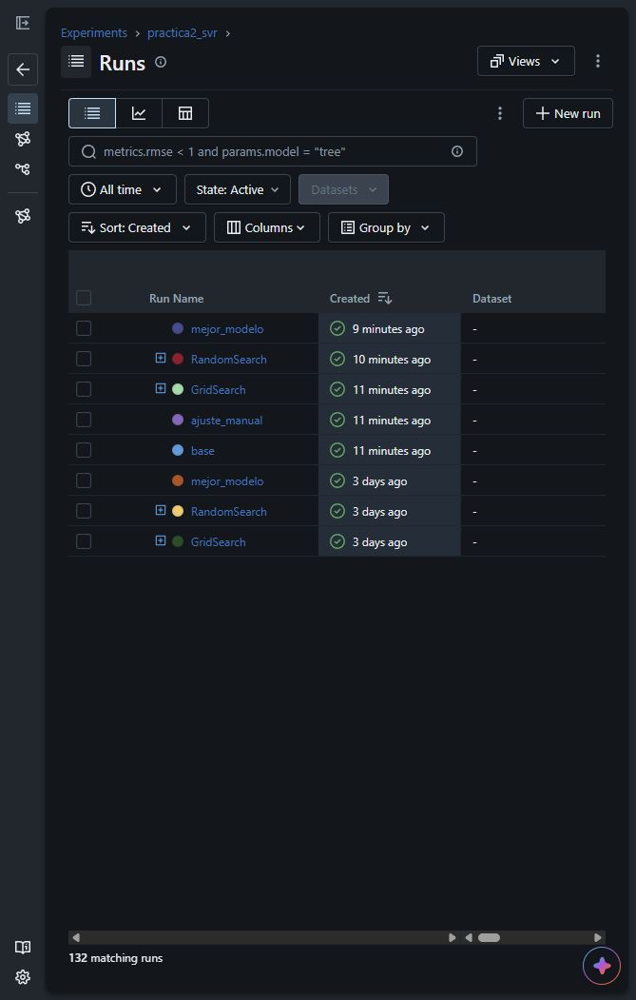
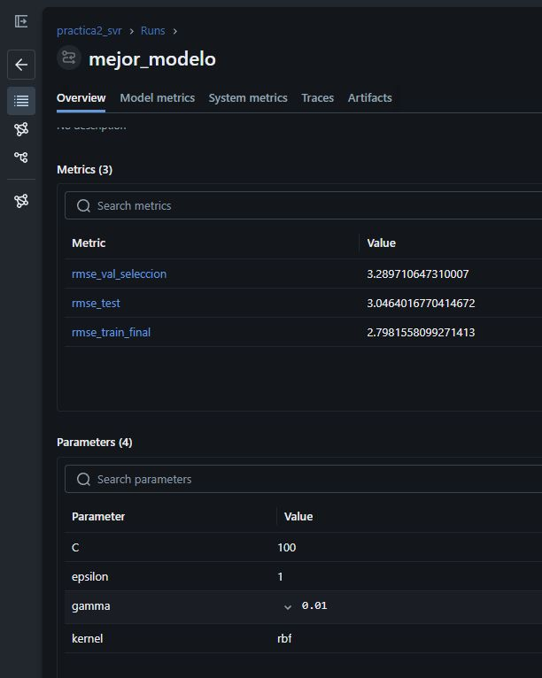
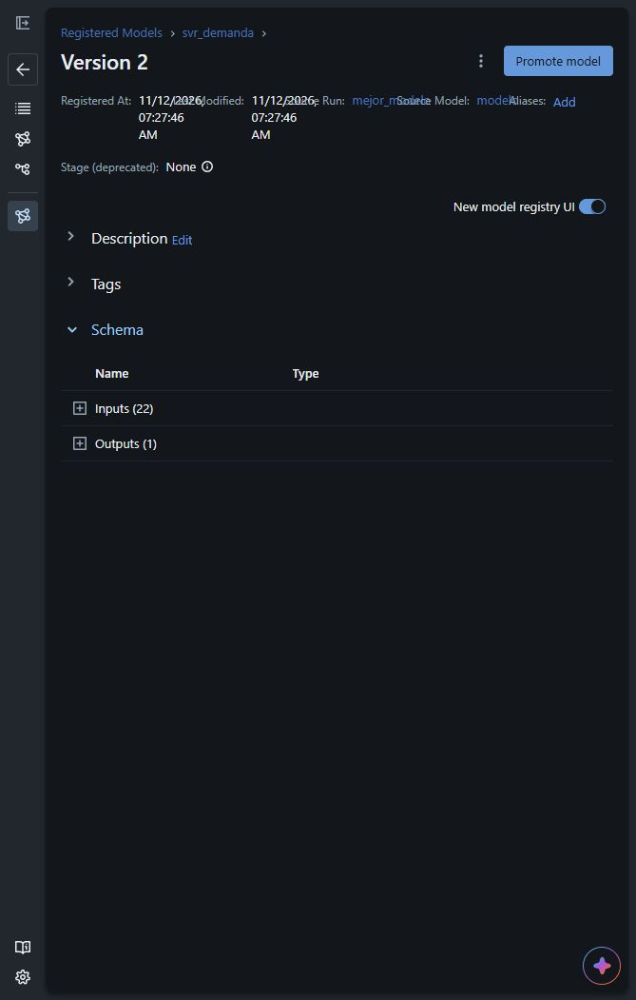

# Estado de la práctica

Actualizado al 12 de noviembre de 2026. Este documento describe el
[notebook actual](../practica2_svm.ipynb), que contiene las Partes 1 y 2.
La explicación y los comandos de ejecución están en el [README principal](../README.md).

## Lo que ya está hecho

### Parte 1: datos y SVR

- [x] Cargar y ordenar las ventas y los productos del escenario sintético.
- [x] Preparar 22 entradas: calendario, fecha numérica, feriados, rezagos de ventas y stock e indicadores de producto.
- [x] Mantener la separación temporal de entrenamiento, validación de agosto y prueba de septiembre.
- [x] Comparar los kernels lineal, RBF y polinomial.
- [x] Estudiar C y épsilon por separado y elegir el ajuste manual con la validación.
- [x] Evaluar en septiembre y comparar con las líneas base y las métricas de la LSTM de la práctica anterior.
- [x] Generar las figuras de kernels, C, épsilon y predicción frente a demanda real.

La SVR elegida en esta etapa usa RBF, C = 10 y épsilon = 0,1. Sus resultados
guardados son RMSE 3,21 y MAE 2,29 en septiembre. La LSTM se usa como referencia;
no se entrena en este notebook.

### Parte 2: fine-tuning con MLflow

- [x] Registrar las ejecuciones `base` y `ajuste_manual`.
- [x] Ejecutar GridSearch con 42 candidatos y RandomSearch con 20 sobre el mismo espacio de parámetros.
- [x] Elegir parámetros mediante la validación de agosto, sin utilizar septiembre en la selección.
- [x] Guardar por candidato sus parámetros, RMSE de entrenamiento y validación, tiempo de ajuste y figura.
- [x] Comparar ambas búsquedas en error y tiempo y exportar los resultados a CSV.
- [x] Reajustar y registrar el pipeline completo, con el escalador incluido.
- [x] Comparar modelo base, ajuste manual y fine-tuning en septiembre.
- [x] Mostrar ejemplos por producto y el desfase entre los pedidos estimados y la demanda real.

GridSearch eligió RBF, C = 100, gamma = 0,01 y épsilon = 1. El RMSE de validación
es 3,2897 y el RMSE de prueba es 3,0464. El registro vigente es
`models:/svr_demanda/2`; la versión 1 se conserva.

## Lo que se comprobó en la última ejecución

- [x] Las 15 celdas de código del notebook terminaron sin errores.
- [x] El código fuente y los CSV de entrada no cambiaron al ejecutar.
- [x] Se actualizaron las salidas del notebook, el HTML, las figuras y los CSV de resultados.
- [x] Los 65 registros previos de MLflow se conservaron.
- [x] Se añadieron 67 ejecuciones terminadas, para un total de 132.
- [x] La interfaz local mostró el historial y la versión 2 del modelo.
- [x] Se guardaron capturas reales de la interfaz en `docs/capturas/mlflow/`.

Los recuentos, las versiones y las capturas corresponden a esa ejecución. Una
nueva ejecución agrega historial y puede cambiar la versión vigente. El archivo
[parte2_modelo.json](../resultados/parte2_modelo.json) identifica el modelo de la
última ejecución; no contiene los archivos del modelo entrenado.

## Lo que falta implementar o confirmar

| Pendiente | Situación actual | Próximo paso |
| --- | --- | --- |
| Función para predecir muestras nuevas | No está en el notebook actual | Confirmar el alcance e incorporar la función que cargue una versión registrada. |
| Interpretación de predicciones con SHAP | No está en el notebook actual | Confirmar si corresponde a esta entrega y explicar los casos cuando se incorpore. |
| Random Forest | No está implementado | Confirmar cuándo lo solicita el docente. |
| Árboles de decisión e Information Gain | Ejercicio de la guía pendiente | Confirmar si entra en esta entrega o en la siguiente etapa. |
| Variable objetivo | Se predice demanda y después se calcula stock | Confirmar que el docente acepta este enfoque frente a predecir stock directamente. |
| Referencias y portada | Referencias incluidas; revisión APA y grupo sin confirmar | Revisar el formato y aclarar los tres integrantes frente al máximo de dos indicado en la guía. |
| Entrega y sustentación | No verificadas | Subir los archivos solicitados al AVAC y preparar la demostración. |

La implementación previa de una función o explicación en otra versión no
equivale a tenerla en el notebook actual. Este estado se basa en los archivos
que están ahora en el proyecto.

## Evidencias

| Evidencia | Qué permite consultar |
| --- | --- |
| [Notebook](../practica2_svm.ipynb) y [HTML ejecutado](../practica2_svm.html) | Desarrollo, tablas, gráficas y salidas de la ejecución. |
| [Experimentos](../resultados/parte2_experimentos.csv) | Los 62 candidatos de las dos búsquedas de la última ejecución. |
| [Comparación](../resultados/parte2_comparacion.csv) | Mejor RMSE de agosto y tiempo de cada búsqueda. |
| [Datos del modelo](../resultados/parte2_modelo.json) | Nombre, versión, URI, parámetros, columnas y métricas. |
| [Figuras](../figuras/) | Las siete figuras generadas por el notebook. |
| [MLflow local](http://127.0.0.1:5000/#/experiments/1) | Historial de ejecuciones, métricas, artefactos y acceso al registro. |
| [Historial compartido](mlflow/README.md) | Copia portable de las 132 ejecuciones y dos versiones, para consultar después de hacer pull sin entrenar. |

### Historial de ejecuciones

### Métricas y parámetros del mejor modelo

### Versión registrada

## Cómo mantener esta documentación

Al cambiar el notebook, revisar el estado y las explicaciones del README.
Después de ejecutarlo, comprobar el JSON y los CSV de resultados. Si cambian
las cifras o las versiones que se quieren mostrar, actualizar los textos y
volver a tomar las capturas; las imágenes no se regeneran al ejecutar el notebook.

El servidor de MLflow se inicia aparte y usa la base `mlflow.db` de la carpeta
del proyecto. No hace falta volver a entrenar para consultar un historial
existente. La base y `mlartifacts/` son locales y no se suben a Git.

La copia de entrega está en `docs/mlflow/` y sí se comparte por Git. Se abre
con el comando directo de MLflow indicado en su README, desde la raíz del
repositorio. Usa rutas relativas y no necesita scripts auxiliares. Es
independiente de la base local de entrenamiento; ambas pueden consultarse en
el puerto 5000, iniciando un solo servidor con la base que se quiera revisar.
